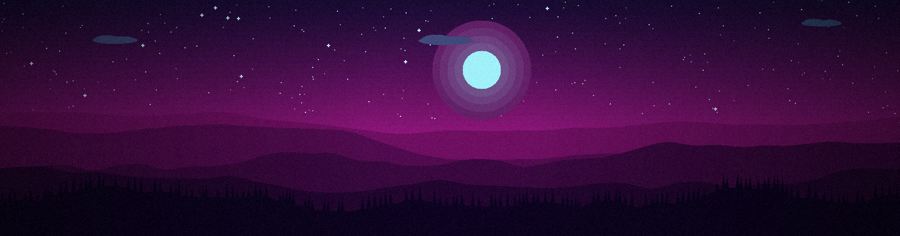
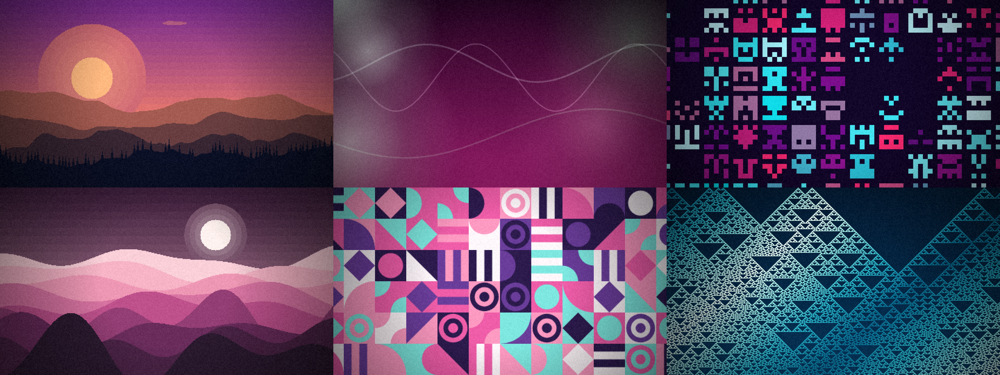
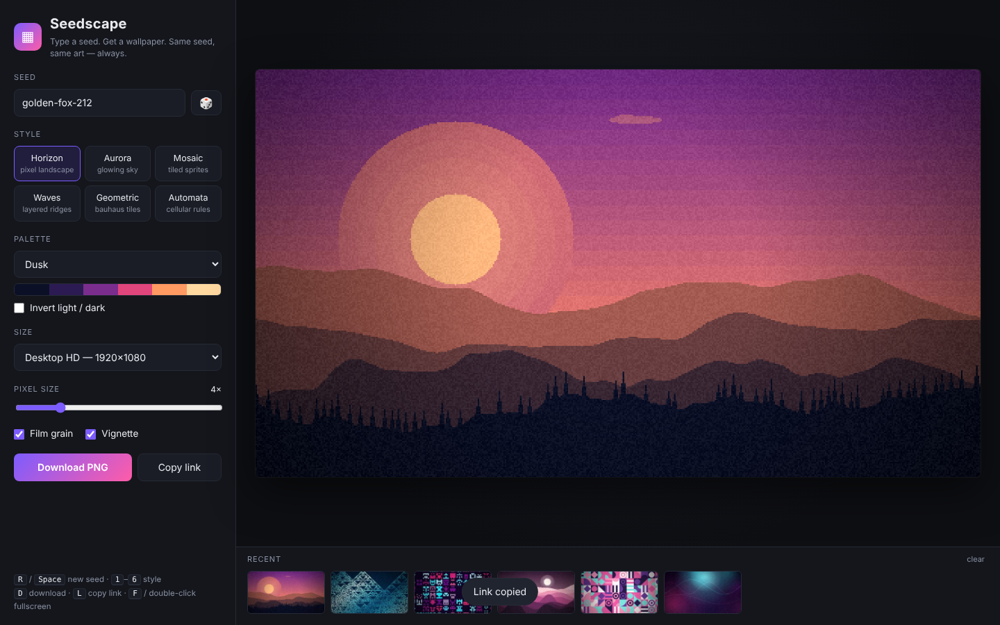
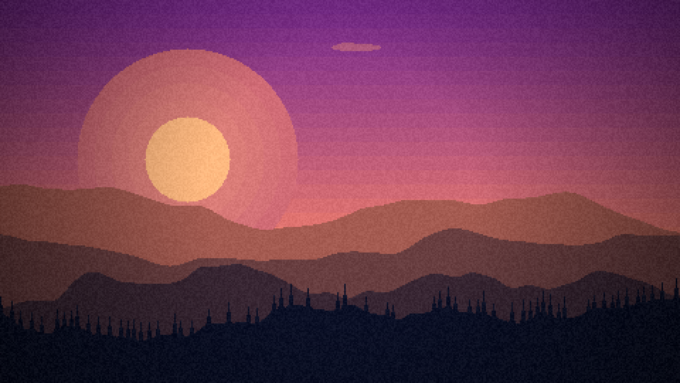
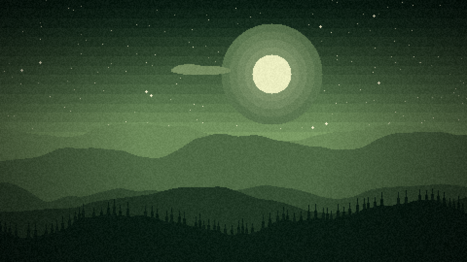
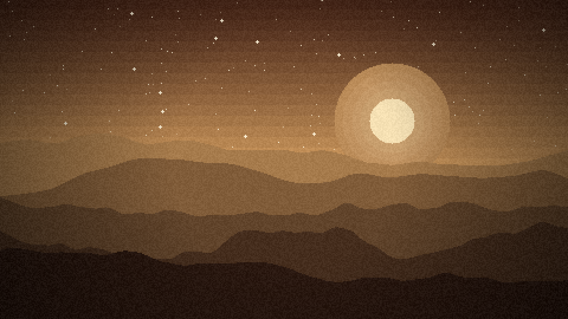
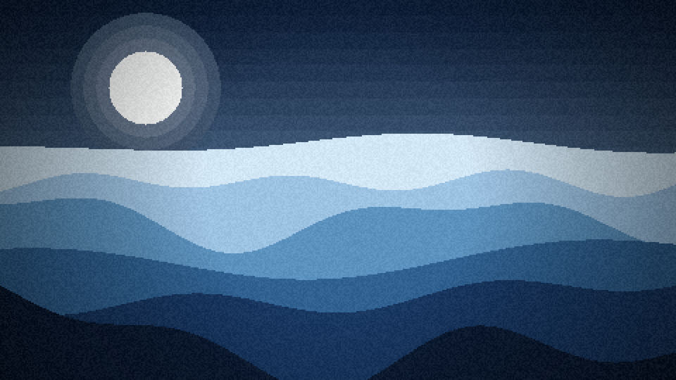
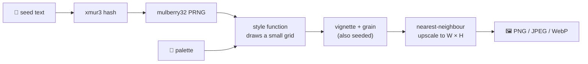

<div align="center">



# ▦ Seedscape

### Type a seed. Get a wallpaper. Same seed, same art — always.

A zero-install **web app** and a tiny **image API** that paint deterministic, shareable wallpapers.<br>
No AI. No accounts. No tracking. Just a seed and some math.

[](https://github.com/mskraban/seedscape/actions/workflows/ci.yml)
[](LICENSE)
[](https://seedscape.vercel.app)
[](package.json)
[](package.json)
[](https://github.com/mskraban/seedscape/stargazers)

**[🎨 Open the app](https://seedscape.vercel.app)** &nbsp;·&nbsp;
**[⚡ Try the API](#-api)** &nbsp;·&nbsp;
**[🧩 Add a style](#-add-your-own-style)** &nbsp;·&nbsp;
**[🚀 Deploy your own](#-deploy-your-own)**

</div>

<br>

<p align="center">
  
</p>

---

## ✨ Highlights

|  |  |
|---|---|
| 🌱 **Reproducible** | The seed fully determines the image. `golden-fox-212` is the same wallpaper on every machine, forever. |
| 🎨 **6 styles · 12 palettes** | Pixel landscapes, glowing skies, tiled sprites, layered ridges, Bauhaus tiles and cellular-automata fractals, plus a palette generated from your seed. |
| 📐 **Any size** | Desktop, 4K, ultrawide, MacBook, iPhone, Android, square, or custom. |
| 🕹️ **Pixel-size dial** | From crunchy retro pixels to smooth native resolution; scales with output size so the look stays consistent. |
| 🔗 **Shareable** | Every setting lives in the URL. Send a link, get the exact same art. |
| ⚡ **Image API** | ``: a PNG/JPEG/WebP from a URL, cached forever. |
| 🔒 **Private by design** | The web app runs 100 % in your browser and works offline. Nothing is uploaded. |
| 🪶 **Tiny** | One drawing engine shared by browser and server, 1 runtime dependency (`@napi-rs/canvas`, API only). |

<p align="center">
  
</p>

---

## 🚀 Quick start

<table>
<tr>
<td width="50%" valign="top">

### 🖥️ Use the web app

```bash
git clone https://github.com/mskraban/seedscape.git
cd seedscape/public
open index.html      # or just double-click it
```

Works offline. No build, no install.

</td>
<td width="50%" valign="top">

### ⚡ Call the API

```bash
curl -o wall.png \
 "https://seedscape.vercel.app/api/wallpaper?seed=hello&style=aurora&palette=neon"
```

Or drop the URL straight into an `` tag.

</td>
</tr>
</table>

---

## ⚡ API

Base URL: **`https://seedscape.vercel.app`**

| Method | Endpoint | Description |
|:------:|----------|-------------|
| `GET` | [`/api/wallpaper`](#get-apiwallpaper) | Render a wallpaper (PNG / JPEG / WebP). |
| `GET` | `/w/:seed` | Short form of the above: `/w/hello?style=waves`. |
| `GET` | `/random` | A fresh random wallpaper on every request. |
| `GET` | [`/api/random`](#get-apirandom) | A random seed + ready-to-use URLs, as JSON. |
| `GET` | [`/api/styles`](#get-apistyles) | Every style, palette, size and limit, as JSON. |

CORS is open (`Access-Control-Allow-Origin: *`), so you can call it from any web page.

### `GET /api/wallpaper`

```
/api/wallpaper?seed=golden-fox-212&style=horizon&palette=dusk&size=1920x1080
```

| Param | Default | Description |
|-------|---------|-------------|
| `seed` | *random* | Any text, up to 200 chars. **Omit it for a random image** (not cached). |
| `style` | `horizon` | `horizon` · `aurora` · `mosaic` · `waves` · `geometric` · `automata` |
| `palette` | `auto` | `auto` (derived from the seed) or a palette id, see [`/api/styles`](#get-apistyles). |
| `size` | `1920x1080` | Shorthand `WxH`. Or use `w` and `h` separately. |
| `w`, `h` | `1920`, `1080` | Width / height in px. Min 64, max 4096, and at most 8.5 megapixels in total. |
| `px` | `4` | Pixel size `1`–`16`. `1` = smooth, native resolution. |
| `grain` | `1` | Film grain: `1` / `0`. |
| `vignette` | `1` | Edge darkening: `1` / `0`. |
| `invert` | `0` | Swap light and dark in the palette. |
| `format` | `png` | `png` · `jpeg` · `webp` |
| `quality` | `90` | `1`–`100`, for `jpeg` and `webp`. |
| `download` | – | Add `download=1` to get a `Content-Disposition: attachment` filename. |

**Response headers**

| Header | Meaning |
|--------|---------|
| `Cache-Control` | `public, max-age=31536000, immutable` when a `seed` is given (same URL ⇒ same image). `no-store` for random images. |
| `X-Seedscape-Seed` | The seed that was used, handy when you omitted it and got a random one. |
| `X-Seedscape-Engine` | Engine version. Bumped only if a change would alter existing seeds. |

**Errors** are JSON with an HTTP status:

```jsonc
// 400
{ "error": "\"style\" must be one of: horizon, aurora, mosaic, waves, geometric, automata",
  "hint": "GET /api/styles lists every valid option." }
```

| Status | When |
|:------:|------|
| `400` | Invalid or out-of-range parameter. |
| `405` | Method other than `GET`, `HEAD`, `OPTIONS`. |
| `413` | Encoded image would exceed Vercel's 4.5 MB response limit (only happens with huge `px=1` + grain PNGs; use `format=webp`). |

### `GET /api/random`

Returns a random seed, style and palette plus URLs that render it.

```json
{
  "seed": "gentle-reef-757",
  "style": "horizon",
  "palette": "pastel",
  "url": "https://seedscape.vercel.app/api/wallpaper?seed=gentle-reef-757&style=horizon&palette=pastel",
  "app": "https://seedscape.vercel.app/#seed=gentle-reef-757&s=horizon&p=Pastel"
}
```

Add `?redirect=1` to be redirected straight to the image.

### `GET /api/styles`

Machine-readable catalogue: styles, palettes (with their hex colours), sizes, formats, defaults and limits. Handy for building your own picker UI.

### 💡 Use it anywhere

<details open>
<summary><b>HTML / Markdown</b></summary>

```html

```

```markdown

```
</details>

<details>
<summary><b>CSS background</b></summary>

```css
body {
  background: #0d0221 url("https://seedscape.vercel.app/api/wallpaper?seed=my-site&style=aurora&palette=neon&size=1920x1080&format=webp") center / cover fixed;
}
```
</details>

<details>
<summary><b>A different wallpaper every day</b></summary>

Use the date as the seed: the image changes daily but is cached all day.

```js
const today = new Date().toISOString().slice(0, 10);   // "2026-10-31"
img.src = `https://seedscape.vercel.app/api/wallpaper?seed=${today}&style=horizon`;
```
</details>

<details>
<summary><b>curl · JavaScript · Python</b></summary>

```bash
curl -s "https://seedscape.vercel.app/api/random"                       # get a random seed as JSON
curl -sJO "https://seedscape.vercel.app/api/wallpaper?seed=hi&download=1"   # save with a proper filename
```

```js
const res = await fetch("https://seedscape.vercel.app/api/wallpaper?seed=hello&format=webp");
const blob = await res.blob();
```

```python
import requests
r = requests.get("https://seedscape.vercel.app/api/wallpaper",
                 params={"seed": "hello", "style": "mosaic", "palette": "game-boy", "size": "800x600"})
open("hello.png", "wb").write(r.content)
```
</details>

<details>
<summary><b>Phone & desktop wallpapers</b></summary>

| Device | URL |
|--------|-----|
| Desktop HD | `/api/wallpaper?seed=hi&size=1920x1080` |
| 4K | `/api/wallpaper?seed=hi&size=3840x2160&format=webp` |
| iPhone | `/api/wallpaper?seed=hi&size=1170x2532` |
| Android | `/api/wallpaper?seed=hi&size=1080x2400` |
| Square / avatar | `/api/wallpaper?seed=hi&size=1024x1024` |
</details>

---

## 🎨 Styles

| Style | Look |
|-------|------|
| 🏔️ **horizon** | Layered pixel-art landscapes with sun or moon, stars, clouds and pines. |
| 🌌 **aurora** | Soft glowing blobs and thin ribbons of light on a dark sky. |
| 👾 **mosaic** | A tiled grid of symmetric, space-invader-style sprites. |
| 🌊 **waves** | Stacked sine ridges under a hazy sun. |
| 🔷 **geometric** | Bauhaus-style tiles: quarter circles, stripes, rings and diamonds. |
| 🔺 **automata** | One-dimensional cellular automata (Rule 30, 90, 110…) painting Sierpiński-like fractals. |

<details>
<summary><b>🎨 Palettes</b> (click to expand)</summary>

`auto` · `dusk` · `ocean` · `forest` · `neon` · `pastel` · `desert` · `candy` · `autumn` · `arctic` · `sakura` · `game-boy` · `mono`

`auto` generates a fresh harmonious palette (analogous, complementary, triad, split or monochrome) from the seed itself.
</details>

<table>
<tr>
<td><br><sub><code>golden-fox-212</code> · horizon · dusk</sub></td>
<td><br><sub><code>misty-cedar-318</code> · horizon · forest</sub></td>
</tr>
<tr>
<td><br><sub><code>amber-canyon-901</code> · horizon · desert</sub></td>
<td><br><sub><code>quiet-harbor-505</code> · waves · arctic</sub></td>
</tr>
</table>

---

## 🧠 How it works



- **One engine, two runtimes.** [`public/engine.js`](public/engine.js) is plain JavaScript on the Canvas 2D API. The browser runs it directly; the API runs the same file in Node with [`@napi-rs/canvas`](https://github.com/Brooooooklyn/canvas).
- **Deterministic.** Every random decision comes from the seeded PRNG: never `Math.random()` while drawing. In tests, the browser and API output differ by at most a few colour levels in anti-aliased gradients.
- **Small grid, crisp upscale.** Styles draw on a low-resolution grid; scaling it up without smoothing creates the pixel-art look. `px=1` skips this and draws at native resolution.
- **Versioned.** If a change would alter what an existing seed produces, `VERSION` in the engine is bumped (and exposed in `X-Seedscape-Engine`).

### Project layout

```
seedscape/
├── public/
│   ├── index.html        # the web app (static)
│   └── engine.js         # the drawing engine: browser + Node
├── api/
│   ├── wallpaper.js      # GET /api/wallpaper
│   ├── random.js         # GET /api/random
│   └── styles.js         # GET /api/styles
├── lib/render.js         # query → validated state → encoded image
├── test/                 # node:test suite (engine + handlers)
├── scripts/dev-server.js # local server that mimics Vercel routes
└── vercel.json           # routes, limits, headers
```

---

## 🛠️ Develop locally

```bash
git clone https://github.com/mskraban/seedscape.git
cd seedscape
npm install
npm test            # 13 tests: determinism, validation, API handlers
npm run dev         # → http://localhost:3000  (app + API)
```

## ☁️ Deploy your own

[](https://vercel.com/new/clone?repository-url=https%3A%2F%2Fgithub.com%2Fmskraban%2Fseedscape)

Or from the CLI: `npm i -g vercel && vercel --prod`. No environment variables are needed.

## 🧩 Add your own style

Styles are plain functions. Add one to `public/engine.js` and it shows up in the app **and** the API automatically.

```js
function stripes(ctx, w, h, rng, pal) {
  // rng.next() → 0..1 · rng.range(a,b) · rng.int(a,b) · rng.pick(arr) · rng.chance(p)
  // pal is sorted dark → light; colorAt(pal, 0..1) samples it smoothly
  const n = rng.int(6, 14);
  for (let i = 0; i < n; i++) {
    ctx.fillStyle = css(colorAt(pal, i / (n - 1)));
    ctx.fillRect(0, Math.floor((i * h) / n), w, Math.ceil(h / n));
  }
}
// then register it:
//   STYLES.stripes = { name: 'Stripes', sub: 'bold bands', draw: stripes };
```

Palettes are just arrays of hex colours in the `PALETTES` object.

## 🗺️ Roadmap

- [x] Deterministic engine with 6 styles
- [x] Web app with shareable links and PNG export
- [x] Image API (PNG / JPEG / WebP) with immutable caching
- [ ] Animated export (GIF / WebM)
- [ ] More styles: isometric cities, topographic lines, stained glass, Truchet tiles
- [ ] Dithering and palette-quantisation options
- [ ] Batch export of many seeds as a ZIP
- [ ] Palette from an uploaded image

## 🤝 Contributing

Ideas and pull requests are very welcome. Good first contributions: a new palette, a new style, or a bug report with the exact URL that shows it (the URL contains everything needed to reproduce).

1. Fork and create a branch
2. `npm test` must pass
3. Open a pull request with a screenshot of what your change looks like

## 📜 License

[MIT](LICENSE) © 2026 Mario Skraban. Wallpapers you generate are yours to use however you like.

<div align="center">
<sub>If you like it, a ⭐ helps others find it.</sub>
</div>
