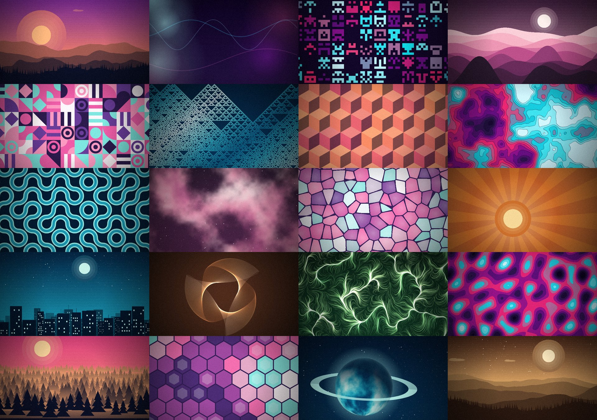
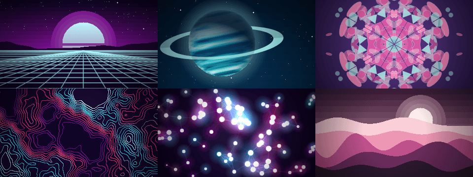
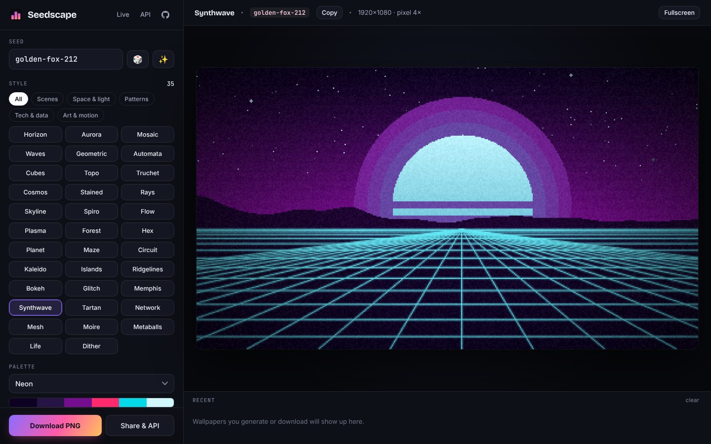
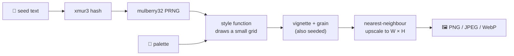
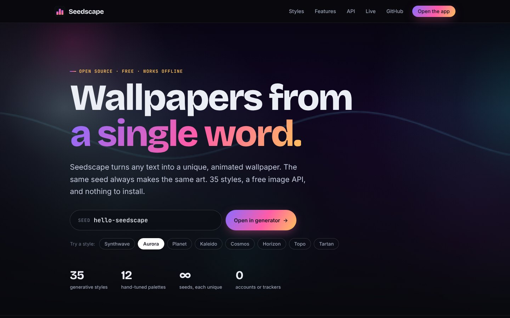

<div align="center">


# ▦ Seedscape

### Type a seed. Get a wallpaper. Same seed, same art — always.

A zero-install **web app** and a tiny **image API** that paint deterministic, shareable wallpapers, <b>and make every one of them move</b>.<br>
No AI. No accounts. No tracking. Just a seed and some math.

[](https://github.com/mskraban/seedscape/actions/workflows/ci.yml)
[](LICENSE)
[](https://seedscape-azure.vercel.app)
[](package.json)
[](package.json)
[](https://github.com/mskraban/seedscape/stargazers)

**[🏠 Website](https://seedscape-azure.vercel.app)** &nbsp;·&nbsp;
**[🎨 Generator](https://seedscape-azure.vercel.app/app)** &nbsp;·&nbsp;
**[🌌 Live wallpaper](https://seedscape-azure.vercel.app/live)** &nbsp;·&nbsp;
**[⚡ API docs](https://seedscape-azure.vercel.app/docs)** &nbsp;·&nbsp;
**[🧩 Add a style](#-add-your-own-style)** &nbsp;·&nbsp;
**[🚀 Deploy your own](#-deploy-your-own)**

</div>

<br>

<p align="center">
  
</p>

---

<p align="center">
  <br>
  <sub>Every style loops seamlessly. These six are synthwave, planet, kaleidoscope, topo, network and waves.</sub>
</p>

---

## ✨ Highlights

|  |  |
|---|---|
| 🌱 **Reproducible** | The seed fully determines the image. `golden-fox-212` is the same wallpaper on every machine, forever. |
| 🎨 **35 styles · 12 palettes** | Pixel landscapes, synthwave suns, mazes, circuit boards, kaleidoscopes, island maps, glitch art, ringed planets and 27 more, plus a palette generated from your seed. |
| 🎞️ **Animated** | All 35 styles move: grids scroll, planets rotate, nebulae drift, kaleidoscopes turn. Every animation is a **seamless loop**. Watch it live, open it fullscreen as a live wallpaper, record it as MP4/WebM, or fetch animated WebP/GIF from the API. |
| 📐 **Any size** | Desktop, 4K, ultrawide, MacBook, iPhone, Android, square, or custom. |
| 🕹️ **Pixel-size dial & blur** | From crunchy retro pixels to smooth native resolution, plus a Gaussian blur slider for dreamy, out-of-focus wallpapers. |
| 🔗 **Shareable** | Every setting lives in the URL. Send a link, get the exact same art. |
| ⚡ **Image API** | ``: a PNG/JPEG/WebP from a URL, cached forever. |
| 🔒 **Private by design** | The web app runs 100 % in your browser and works offline. Nothing is uploaded. |
| 🪶 **Tiny** | One drawing engine shared by browser and server, 1 runtime dependency (`@napi-rs/canvas`, API only). |

<p align="center">
  
</p>

---

## 🚀 Quick start

<table>
<tr>
<td width="50%" valign="top">

### 🖥️ Use the web app

```bash
git clone https://github.com/mskraban/seedscape.git
cd seedscape/public
open app.html        # or just double-click it
```

Works offline. No build, no install.

</td>
<td width="50%" valign="top">

### ⚡ Call the API

```bash
curl -o wall.png \
 "https://seedscape-azure.vercel.app/api/wallpaper?seed=hello&style=aurora&palette=neon"
```

Or drop the URL straight into an `` tag. Add `&animate=1` for an animated loop.

</td>
</tr>
</table>

---

## ⚡ API

Base URL: **`https://seedscape-azure.vercel.app`**

| Method | Endpoint | Description |
|:------:|----------|-------------|
| `GET` | [`/api/wallpaper`](#get-apiwallpaper) | Render a wallpaper (PNG / JPEG / WebP). |
| `GET` | `/w/:seed` | Short form of the above: `/w/hello?style=waves`. |
| `GET` | `/random` | A fresh random wallpaper on every request. |
| `GET` | [`/live`](#-live-wallpaper) | A fullscreen, endlessly animating wallpaper page. |
| `GET` | [`/api/random`](#get-apirandom) | A random seed + ready-to-use URLs, as JSON. |
| `GET` | [`/api/styles`](#get-apistyles) | Every style, palette, size and limit, as JSON. |

CORS is open (`Access-Control-Allow-Origin: *`), so you can call it from any web page.

### `GET /api/wallpaper`

```
/api/wallpaper?seed=golden-fox-212&style=horizon&palette=dusk&size=1920x1080
```

| Param | Default | Description |
|-------|---------|-------------|
| `seed` | *random* | Any text, up to 200 chars. **Omit it for a random image** (not cached). |
| `style` | `horizon` | One of the 35 [styles](#-styles) below, e.g. `horizon`, `synthwave`, `maze`, `planet`. |
| `palette` | `auto` | `auto` (derived from the seed) or a palette id, see [`/api/styles`](#get-apistyles). |
| `size` | `1920x1080` | Shorthand `WxH`. Or use `w` and `h` separately. |
| `w`, `h` | `1920`, `1080` | Width / height in px. Min 64, max 4096, and at most 8.5 megapixels in total. |
| `px` | `4` | Pixel size `1`–`16`. `1` = smooth, native resolution. |
| `blur` | `0` | Gaussian blur `0`–`30` (scales with image size). Grain and vignette are applied *after* the blur so they stay crisp. |
| `animate` | – | `animate=1` returns a seamlessly looping **animated WebP or GIF** instead of a still. See [Animated images](#-animated-images). |
| `grain` | `1` | Film grain: `1` / `0`. |
| `vignette` | `1` | Edge darkening: `1` / `0`. |
| `invert` | `0` | Swap light and dark in the palette. |
| `format` | `png` | `png` · `jpeg` · `webp` (animated: `webp` · `gif`) |
| `quality` | `90` | `1`–`100`, for `jpeg` and `webp`. |
| `download` | – | Add `download=1` to get a `Content-Disposition: attachment` filename. |

**Response headers**

| Header | Meaning |
|--------|---------|
| `Cache-Control` | `public, max-age=31536000, immutable` when a `seed` is given (same URL ⇒ same image). `no-store` for random images. |
| `X-Seedscape-Seed` | The seed that was used, handy when you omitted it and got a random one. |
| `X-Seedscape-Engine` | Engine version. Bumped only if a change would alter existing seeds. |

**Errors** are JSON with an HTTP status:

```jsonc
// 400
{ "error": "\"style\" must be one of: horizon, aurora, mosaic, waves, geometric, automata, cubes, …",
  "hint": "GET /api/styles lists every valid option." }
```

| Status | When |
|:------:|------|
| `400` | Invalid or out-of-range parameter. |
| `405` | Method other than `GET`, `HEAD`, `OPTIONS`. |
| `413` | Encoded image would exceed Vercel's 4.5 MB response limit (only happens with huge `px=1` + grain PNGs; use `format=webp`). |

### `GET /api/random`

Returns a random seed, style and palette plus URLs that render it.

```json
{
  "seed": "gentle-reef-757",
  "style": "horizon",
  "palette": "pastel",
  "url": "https://seedscape-azure.vercel.app/api/wallpaper?seed=gentle-reef-757&style=horizon&palette=pastel",
  "app": "https://seedscape-azure.vercel.app/#seed=gentle-reef-757&s=horizon&p=Pastel"
}
```

Add `?redirect=1` to be redirected straight to the image.

### `GET /api/styles`

Machine-readable catalogue: styles, palettes (with their hex colours), sizes, formats, defaults and limits. Handy for building your own picker UI.

### 🎞️ Animated images

Add `animate=1` and the same URL returns a loop. Frame *i* of *N* is drawn at loop time *i ⁄ N*, so the last frame flows straight back into the first.

```
/api/wallpaper?seed=golden-fox-212&style=synthwave&palette=neon&animate=1
/api/wallpaper?seed=hello&style=planet&animate=1&frames=36&fps=18&format=gif&size=640x360
```

| Param | Default | Description |
|-------|---------|-------------|
| `animate` | – | `1` to animate. |
| `frames` | `24` | Number of frames, `4`–`48`. |
| `fps` | `12` | Playback speed, `1`–`30`. The loop lasts `frames ÷ fps` seconds (default 2 s). |
| `format` | `webp` | `webp` (small, great quality) or `gif` (works everywhere). |
| `size` / `w`,`h` | `960x540` | Max 1 megapixel per frame, and `frames × w × h` ≤ 13 megapixels. |
| `grain` | `0` | Off by default: fresh grain on every frame makes files much bigger. |

All the other parameters (`style`, `palette`, `px`, `blur`, `vignette`, `invert`) work as usual. Responses include `X-Seedscape-Frames` and `X-Seedscape-Fps` headers and are cached forever when a `seed` is given.

> **Why the small limits?** Each frame is a full render, and the API runs on serverless functions with a 1 GB memory and 4.5 MB response ceiling. For longer, bigger or smoother animation use the [live page](#-live-wallpaper) or record a loop in the app, both run on your own GPU/CPU.

### 🌌 Live wallpaper

[`/live`](https://seedscape-azure.vercel.app/live) is a fullscreen page that animates one wallpaper forever. Put it on a second monitor, use it as a browser start page, or feed it to a live-wallpaper tool such as [Lively](https://github.com/rocksdanister/lively) (Windows) as a URL.

```
https://seedscape-azure.vercel.app/live#seed=golden-fox-212&s=synthwave&p=Neon&d=12
https://seedscape-azure.vercel.app/live#c=60&shuffle=1        # a new seed and style every minute
```

| Option | Meaning |
|--------|---------|
| `seed`, `s`, `p` | seed, style id, palette (as in the app) |
| `px`, `b` | pixel size 1–16, blur 0–30 |
| `d` | loop length in seconds, `2`–`60` (default 12) |
| `c` | pick a fresh seed every *c* seconds (`0` = never) |
| `shuffle=1` | with `c`, also pick a random style each time |
| `ui=0` | never show the on-screen hint |

Keys: `R` / `Space` new wallpaper · `[` `]` previous/next style · `P` pause · `F` fullscreen · `H` hide the hint. It honours your system's *reduce motion* setting by starting paused (add `motion=1` to override).

### 💡 Use it anywhere

<details open>
<summary><b>HTML / Markdown</b></summary>

```html

```

```markdown

```
</details>

<details>
<summary><b>CSS background</b></summary>

```css
body {
  background: #0d0221 url("https://seedscape-azure.vercel.app/api/wallpaper?seed=my-site&style=aurora&palette=neon&size=1920x1080&format=webp") center / cover fixed;
}
```
</details>

<details>
<summary><b>A different wallpaper every day</b></summary>

Use the date as the seed: the image changes daily but is cached all day.

```js
const today = new Date().toISOString().slice(0, 10);   // "2026-10-31"
img.src = `https://seedscape-azure.vercel.app/api/wallpaper?seed=${today}&style=horizon`;
```
</details>

<details>
<summary><b>curl · JavaScript · Python</b></summary>

```bash
curl -s "https://seedscape-azure.vercel.app/api/random"                       # get a random seed as JSON
curl -sJO "https://seedscape-azure.vercel.app/api/wallpaper?seed=hi&download=1"   # save with a proper filename
```

```js
const res = await fetch("https://seedscape-azure.vercel.app/api/wallpaper?seed=hello&format=webp");
const blob = await res.blob();
```

```python
import requests
r = requests.get("https://seedscape-azure.vercel.app/api/wallpaper",
                 params={"seed": "hello", "style": "mosaic", "palette": "game-boy", "size": "800x600"})
open("hello.png", "wb").write(r.content)
```
</details>

<details>
<summary><b>Animated header for your README</b></summary>

```markdown

```
</details>

<details>
<summary><b>Phone & desktop wallpapers</b></summary>

| Device | URL |
|--------|-----|
| Desktop HD | `/api/wallpaper?seed=hi&size=1920x1080` |
| 4K | `/api/wallpaper?seed=hi&size=3840x2160&format=webp` |
| iPhone | `/api/wallpaper?seed=hi&size=1170x2532` |
| Android | `/api/wallpaper?seed=hi&size=1080x2400` |
| Square / avatar | `/api/wallpaper?seed=hi&size=1024x1024` |
</details>

---

## 🎬 Animating in the app

Tick **Animate** (or press `A`) and the wallpaper starts moving. Everything stays editable while it plays: change the seed, style, palette or blur and the animation follows.

- **Loop length** sets how many seconds one loop takes (2–30 s).
- **⏺ Record loop** records exactly one loop as an **MP4** (or WebM, depending on your browser) at up to 1280 px, ready to use as a phone live wallpaper or to share. It plays back seamlessly.
- **Open live ↗** opens the [fullscreen live page](#-live-wallpaper) with your current settings.
- **Download PNG** always saves a full-size still, even while animating.

Everything runs in your browser; nothing is uploaded.

---

## 🎨 Styles

35 styles, all deterministic, all available in the app (keys `1`–`9`, `[` / `]` to cycle) and in the API (`style=<id>`).

| `id` | Look |
|------|------|
| 🏔️ `horizon` | Layered pixel-art landscapes with sun or moon, stars, clouds and pines. |
| 🌌 `aurora` | Soft glowing blobs and thin ribbons of light on a dark sky. |
| 👾 `mosaic` | A tiled grid of symmetric, space-invader-style sprites. |
| 🌊 `waves` | Stacked sine ridges under a hazy sun. |
| 🔷 `geometric` | Bauhaus-style tiles: quarter circles, stripes, rings and diamonds. |
| 🔺 `automata` | One-dimensional cellular automata (Rule 30, 90, 110…) painting Sierpiński-like fractals. |
| 🧊 `cubes` | Isometric "tumbling blocks" in three shades. |
| 🗺️ `topo` | Contour-map terrain, either filled bands or glowing lines only. |
| 🌀 `truchet` | Quarter-arc ribbons that tile into endless winding paths. |
| ✨ `cosmos` | Nebula clouds and a scatter of stars. |
| 🪟 `stained` | Voronoi cells with dark lead lines, like stained glass. |
| ☀️ `rays` | A retro sunburst with a glowing sun. |
| 🌃 `skyline` | A night city in three depth layers with lit windows and a moon. |
| 🌸 `spiro` | Layered hypotrochoids with additive glow. |
| 🌿 `flow` | Thousands of particles tracing a noise field into silky streams. |
| 🔮 `plasma` | Interfering sine waves, smooth or posterised. |
| 🌲 `forest` | Rows of pines receding into fog. |
| 🐝 `hex` | A honeycomb mosaic coloured by a noise field. |
| 🪐 `planet` | A shaded world with atmosphere, optional ring and starry sky. |
| 🌀 `maze` | A spanning-tree maze, coloured by distance from the start. |
| 🔌 `circuit` | 45° circuit-board traces, pads and chips. |
| ❄️ `kaleido` | N-fold mirrored translucent shapes, like a kaleidoscope. |
| 🏝️ `islands` | A top-down archipelago map with hill-shading and shoreline foam. |
| 📈 `ridgelines` | Stacked, noisy line plots in the style of a famous pulsar album cover. |
| 🫧 `bokeh` | Soft, out-of-focus light discs. |
| 📺 `glitch` | Broken signal: sliced rows, RGB-split and scanlines. |
| 🎉 `memphis` | 80s confetti of squiggles, triangles, crosses and dots. |
| 🌆 `synthwave` | A striped neon sun over a perspective grid and dark hills. |
| 🧶 `tartan` | Woven plaid from overlapping translucent stripes. |
| 🕸️ `network` | Glowing nodes linked by their nearest neighbours. |
| 🌫️ `mesh` | A smooth gradient mesh, the modern desktop-wallpaper look. |
| 〰️ `moire` | Overlapping ring systems whose interference makes shimmering patterns. |
| 🫠 `metaballs` | Merging blobs contoured into colour bands. |
| 🧬 `life` | Conway's Game of Life with age colouring and fading trails. |
| 🎞️ `dither` | Ordered Bayer dithering of a smooth field into 2–4 colours. Try `px=8`. |

<details>
<summary><b>🎨 Palettes</b> (click to expand)</summary>

`auto` · `dusk` · `ocean` · `forest` · `neon` · `pastel` · `desert` · `candy` · `autumn` · `arctic` · `sakura` · `game-boy` · `mono`

`auto` generates a fresh harmonious palette (analogous, complementary, triad, split or monochrome) from the seed itself.
</details>

<table>
<tr>
<td><br><sub><code>golden-fox-212</code> · horizon · dusk</sub></td>
<td><br><sub><code>misty-cedar-318</code> · horizon · forest</sub></td>
</tr>
<tr>
<td><br><sub><code>amber-canyon-901</code> · horizon · desert</sub></td>
<td><br><sub><code>quiet-harbor-505</code> · waves · arctic</sub></td>
</tr>
</table>

---

## 🧠 How it works



- **One engine, two runtimes.** [`public/engine.js`](public/engine.js) is plain JavaScript on the Canvas 2D API. The browser runs it directly; the API runs the same file in Node with [`@napi-rs/canvas`](https://github.com/Brooooooklyn/canvas).
- **Deterministic.** Every random decision comes from the seeded PRNG: never `Math.random()` while drawing. In tests, the browser and API output differ by at most a few colour levels in anti-aliased gradients.
- **Seamless loops by construction.** Each style takes an optional `time` in `[0, 1)`. All motion uses whole numbers of cycles (`sin(k·2πt)`), drifts on circles through noise space, or scrolls by exactly one pattern period, so `t = 1` is *identical* to `t = 0`. A test checks this for every style. Without `time`, a style draws the normal still, byte-for-byte unchanged.
- **Small grid, crisp upscale.** Styles draw on a low-resolution grid; scaling it up without smoothing creates the pixel-art look. `px=1` skips this and draws at native resolution.
- **Versioned and frozen.** New styles never change old seeds. A test pins the output hashes of existing styles, and if a change would alter what an existing seed produces, `VERSION` in the engine is bumped (and exposed in `X-Seedscape-Engine`).

### Project layout

```
seedscape/
├── public/
│   ├── index.html        # homepage (hero, live style gallery, FAQ, SEO)
│   ├── app.html          # the generator / dashboard  →  /app
│   ├── docs.html         # API docs (generated: npm run docs)  →  /docs
│   ├── live.html         # fullscreen live wallpaper page  →  /live
│   ├── engine.js         # the drawing engine: browser + Node
│   ├── fonts.css, site.css, fonts/   # self-hosted fonts and shared styles
│   └── og.png, favicon*, manifest, robots.txt, sitemap.xml, llms.txt, 404.html
├── api/
│   ├── wallpaper.js      # GET /api/wallpaper
│   ├── random.js         # GET /api/random
│   └── styles.js         # GET /api/styles
├── lib/render.js         # query → validated state → encoded image
├── test/                 # node:test suite (engine + handlers)
├── scripts/
│   ├── dev-server.js     # local server that mimics Vercel routes
│   ├── build-docs.js     # generates public/docs.html from the engine
│   └── make-assets.js    # generates icons and the social preview image
└── vercel.json           # routes, limits, headers
```

---

## 🛠️ Develop locally

```bash
git clone https://github.com/mskraban/seedscape.git
cd seedscape
npm install
npm test            # 34 tests: determinism, frozen stills, loops, blur, API, SEO and site integrity
npm run dev         # → http://localhost:3000  (site + app + API)
npm run docs        # regenerate public/docs.html after changing styles or parameters
npm run assets      # regenerate icons and the 1200×630 social image
```

## 🌐 The website

<p align="center">
  
</p>

| Route | Page |
|-------|------|
| [`/`](https://seedscape-azure.vercel.app) | Homepage: interactive hero (type a seed, the background changes), a live gallery of all 35 styles that animate on hover, features, API samples and FAQ. |
| [`/app`](https://seedscape-azure.vercel.app/app) | The generator: category filters, **Surprise me**, blur, animation, loop recorder, size presets, recent history and a **Share & API** panel that builds the image, animated, live-wallpaper, Markdown and HTML snippets for your current settings. Press `?` for shortcuts. |
| [`/docs`](https://seedscape-azure.vercel.app/docs) | Full API reference with live example images. Generated from the engine, so it cannot go stale (a test enforces it). |
| [`/live`](https://seedscape-azure.vercel.app/live) | Fullscreen animated wallpaper. |

**Typography:** [Inter](https://rsms.me/inter/) for text, [Bricolage Grotesque](https://github.com/ateliertriay/bricolage) for headings and [JetBrains Mono](https://www.jetbrains.com/lp/mono/) for code and seeds. All three are self-hosted variable fonts under the SIL Open Font License (see `public/fonts/`), so there are no third-party requests and the app still works offline.

**SEO:** every page has a unique title and description, a canonical URL, Open Graph and Twitter cards with a generated 1200×630 image, JSON-LD structured data (WebSite, SoftwareApplication, FAQPage, TechArticle), a sitemap, `robots.txt`, a web manifest, `llms.txt` and sensible cache headers. `npm test` checks all of it, so a regression fails CI. If you deploy under your own domain, search-and-replace `seedscape-azure.vercel.app` in `public/` and `scripts/`, then run `npm run docs`.

## ☁️ Deploy your own

[](https://vercel.com/new/clone?repository-url=https%3A%2F%2Fgithub.com%2Fmskraban%2Fseedscape)

Or from the CLI: `npm i -g vercel && vercel --prod`. No environment variables are needed.

## 🧩 Add your own style

Styles are plain functions. Add one to `public/engine.js` and it shows up in the app **and** the API automatically.

```js
function stripes(ctx, w, h, rng, pal, time) {
  // rng.next() → 0..1 · rng.range(a,b) · rng.int(a,b) · rng.pick(arr) · rng.chance(p)
  // pal is sorted dark → light; colorAt(pal, 0..1) samples it smoothly
  const n = rng.int(6, 14), ap = time === undefined ? 0 : time * 2 * Math.PI; // ap: animation phase, 0 → 2π per loop
  for (let i = 0; i < n; i++) {
    ctx.fillStyle = css(colorAt(pal, i / (n - 1)));
    const wobble = Math.sin(ap + i) * 3;             // whole cycles per loop ⇒ seamless
    ctx.fillRect(0, Math.floor((i * h) / n + wobble), w, Math.ceil(h / n));
  }
}
// then register it:
//   STYLES.stripes = { name: 'Stripes', sub: 'bold bands', draw: stripes };
```

Palettes are just arrays of hex colours in the `PALETTES` object. The optional `time` argument makes a style animate: it is `undefined` for stills and a number in `[0, 1)` for animation frames. Use whole cycles (`sin(ap + …)`, `sin(2·ap + …)`) so the loop is seamless; `npm test` checks the seam for you.

## 🗺️ Roadmap

- [x] Deterministic engine with 35 styles and Gaussian blur
- [x] Web app with shareable links and PNG export
- [x] Image API (PNG / JPEG / WebP) with immutable caching
- [x] Seamless animation for every style: live, fullscreen page, video recorder, animated API
- [ ] Audio-reactive mode for the live page
- [ ] Longer, higher-quality server-side video (MP4) export
- [ ] Even more styles: pixel portraits, isometric cities, mandalas, topographic 3D, weather
- [ ] Dithering and palette-quantisation options
- [ ] Batch export of many seeds as a ZIP
- [ ] Palette from an uploaded image

## 🤝 Contributing

Ideas and pull requests are very welcome. See [CONTRIBUTING.md](CONTRIBUTING.md) for setup, the checklist for adding a style, and how to report issues. Good first contributions: a new palette, a new style, or a bug report with the exact URL that shows it (the URL contains everything needed to reproduce).

1. Fork and create a branch
2. `npm test` must pass
3. Open a pull request with a screenshot of what your change looks like

## 📜 License

[MIT](LICENSE) © 2026 Mario Skraban. Bundled fonts are under the [SIL Open Font License](public/fonts/) (see [NOTICE.md](NOTICE.md)). Wallpapers you generate are yours to use however you like.

<div align="center">
<sub>If you like it, a ⭐ helps others find it.</sub>
</div>
